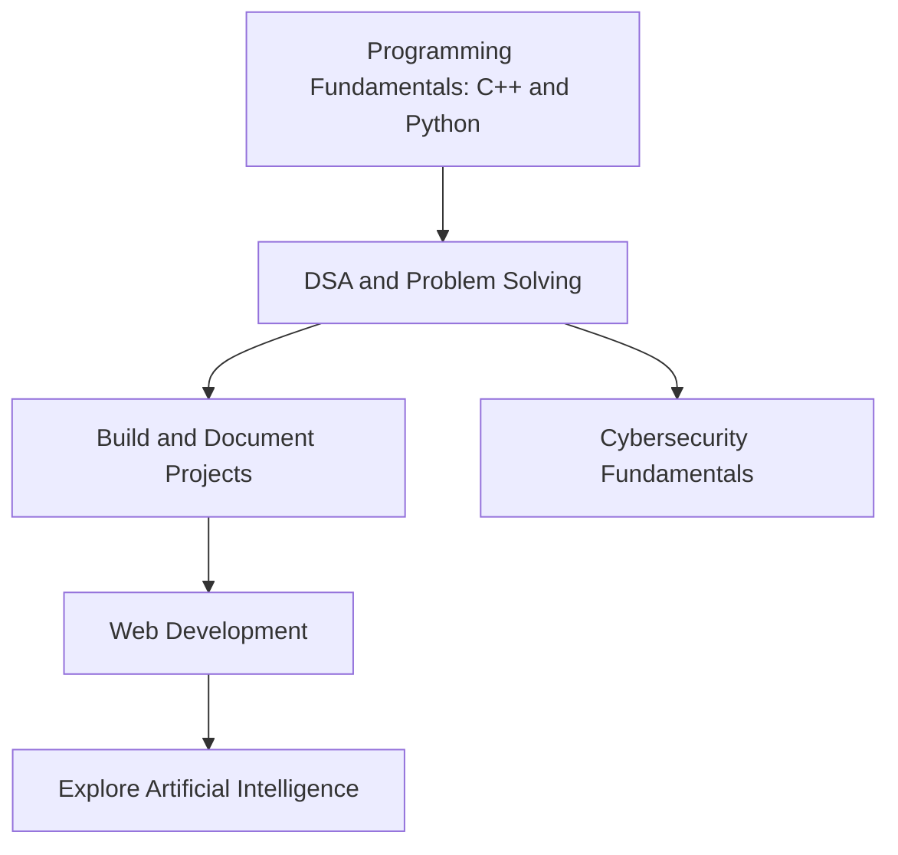

# Hi, I'm Habib Riaz 👋

### Computer Science Student | C++ & Python | Learning by Building

---

## 👨‍💻 About Me

- 🎓 Computer Science student focused on practical learning and problem-solving.
- 💻 Working with **C++** and **Python**.
- 🧠 Practicing **Data Structures & Algorithms (DSA)**.
- 🌐 Learning **Web Development** alongside university studies.
- 🤖 Interested in learning **Artificial Intelligence**.
- 🛡️ Interested in learning **Cybersecurity** and security fundamentals.
- 🚀 I prefer building projects, documenting what I learn, and improving step by step.

> AI, cybersecurity, and web development are learning goals. I am not presenting them as professional expertise.

## 🚀 Projects

### 🚦 Traffic Management System
**Status: Built**

A traffic management project. The repository README should describe the exact features implemented, how to run the project, and include sample output or screenshots.

**Tech:** Add only the language and tools actually used in the project.

**Repository:** Add the real repository URL after publishing the project.

### 🏫 Campus Flow — Campus Complaint Management System
**Status: In progress**

A campus complaint-management system I am developing as a **DSA project**. The aim is to organize complaint submission and tracking while applying data structures and problem-solving concepts.

**Tech:** C++ / DSA (update this if the implementation changes).

**Repository:** Add the real repository URL when it is created or published.

## 📈 GitHub Activity

<!-- This chart updates from public GitHub activity; it may take a little time to refresh. -->

> These cards are generated from public GitHub data. They may show little data until you publish repositories and make contributions.

## 🧭 Learning Roadmap

## 🤝 How I Approach Development

- **Build, then document:** explain how to install, run, and test each project.
- **Be accurate:** list only technologies and features actually used.
- **Learn in public:** share progress, lessons learned, and meaningful improvements.
- **Keep improving:** refactor code and fix issues instead of chasing repository counts.

## 🧰 Skills & Learning Path

- **Programming:** C++, Python
- **Tools:** Git, GitHub, VS Code
- **Currently studying:** DSA, databases, web development fundamentals
- **Future learning goals:** Artificial Intelligence, Cybersecurity

## 🎯 Current Goals

- Complete and document the Campus Flow project.
- Publish clear, reproducible project repositories with setup instructions and screenshots.
- Add tests or sample runs where appropriate, and keep project documentation up to date.
- Strengthen C++ and DSA fundamentals through practice.
- Continue learning web development, then build foundations in AI and cybersecurity.

---

*Learn with purpose. Build real things. Improve every iteration.*

